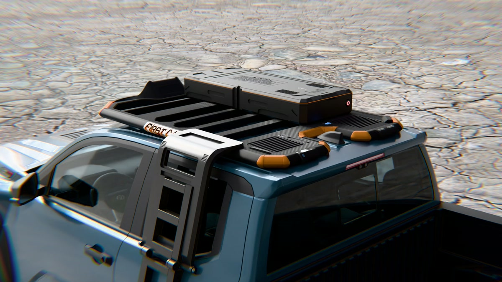
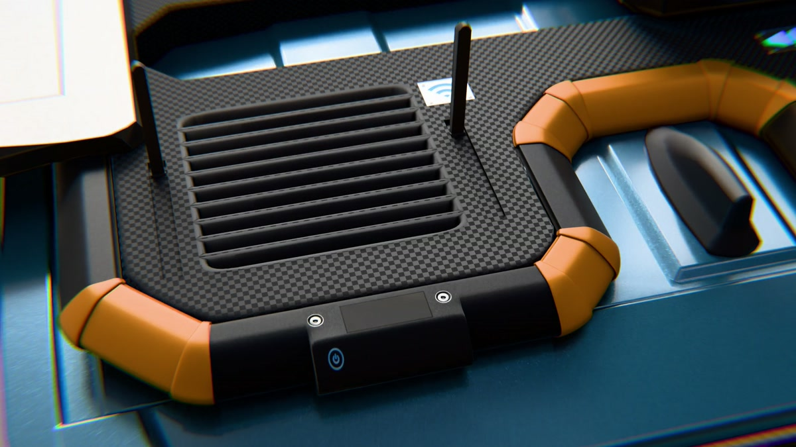
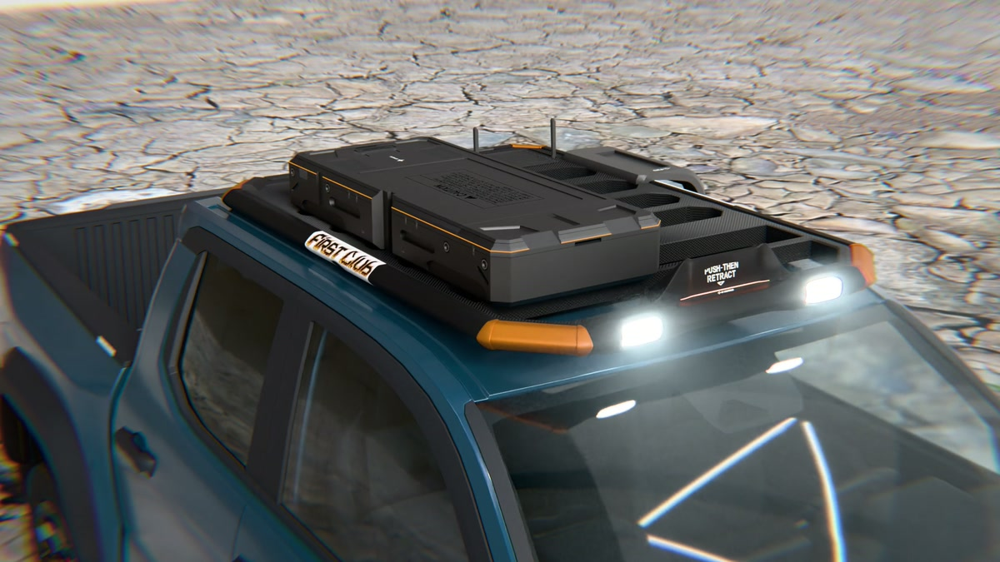

> **分类**：建模渲染 ｜ **类型**：练习 ｜ **完成时间**：2026-11-25
>
> **使用工具**：Blender

## 说明

车顶架与车顶箱的建模渲染练习，接在之前那组白底图作品后面，这次做成动画。

按参考照片还原架体：行李架的横杆截面、两端固定座的分件、夹爪和螺栓都单独建了出来，橙色护角是独立零件，方便后期调整配色。车顶箱按产品结构做，上盖的蜂窝加强筋、边角的防撞块、底部的锁扣与无线充电标识都单独处理，箱盖的开合缝留了一道很浅的凹槽。

动画以箱体的细节为主，镜头从车顶斜前方缓慢环绕，中途压到低角度掠过车顶，再切到箱盖顶面做特写，最后收到整车前脸。

## 动图

## 预览

