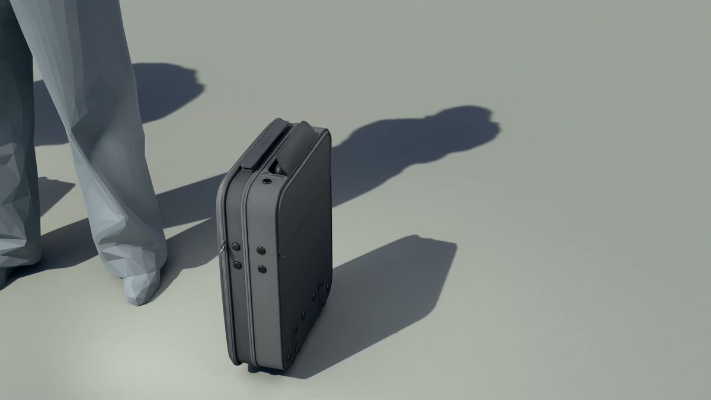

> **分类**：建模渲染 ｜ **类型**：练习 ｜ **完成时间**：2026-11-07
>
> **使用工具**：Blender

## 说明

手提箱产品渲染练习。按参考搭出箱体的硬边结构，重点处理拉链压边、分模线与拉杆、脚轮之间的分件配合；外壳的皮革与箱体的织物做了两种表面，在同一个箱子上区分质感。旁边立了一个低多边形人偶作比例参照，让箱子的尺度更好读。

## 动图

## 预览

