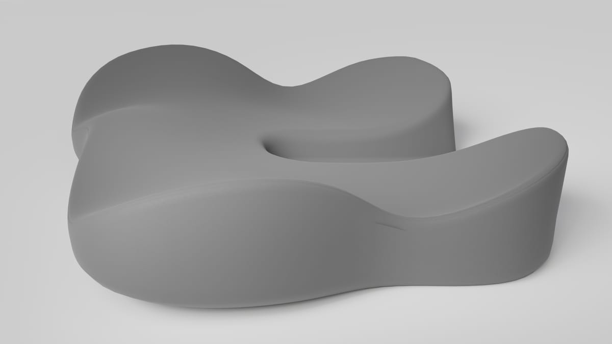
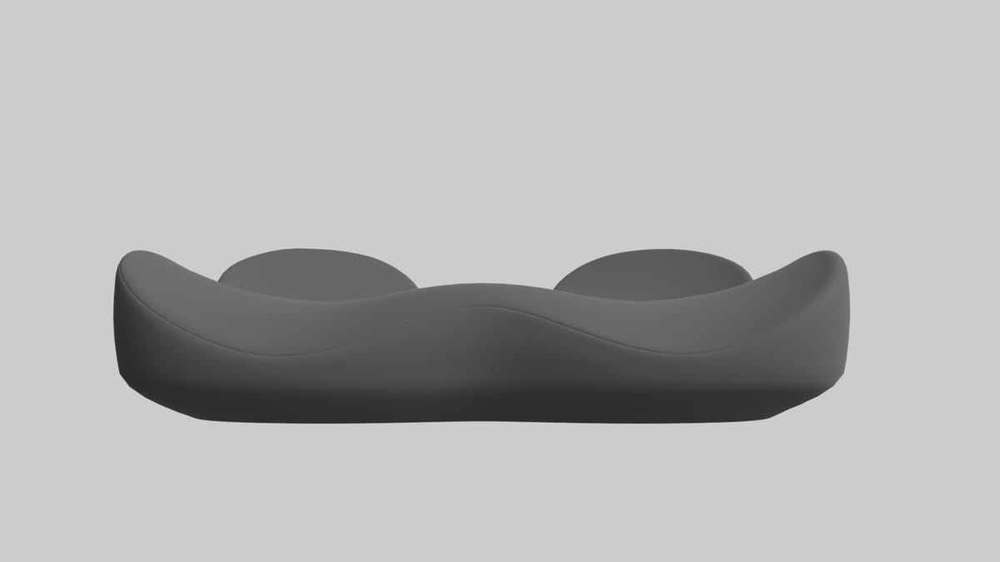
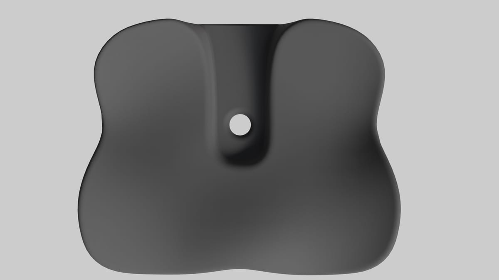
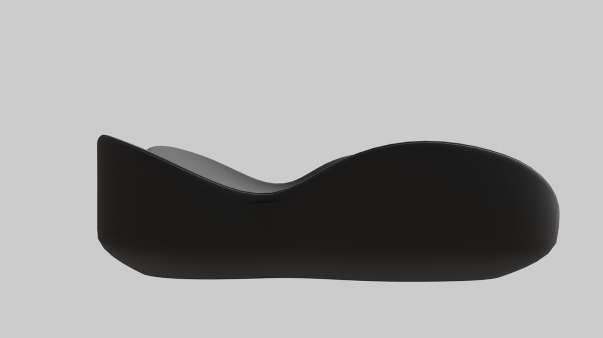
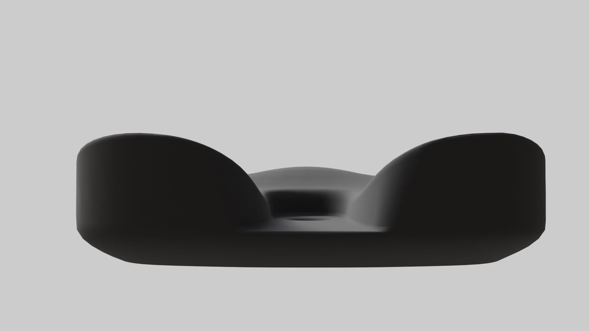
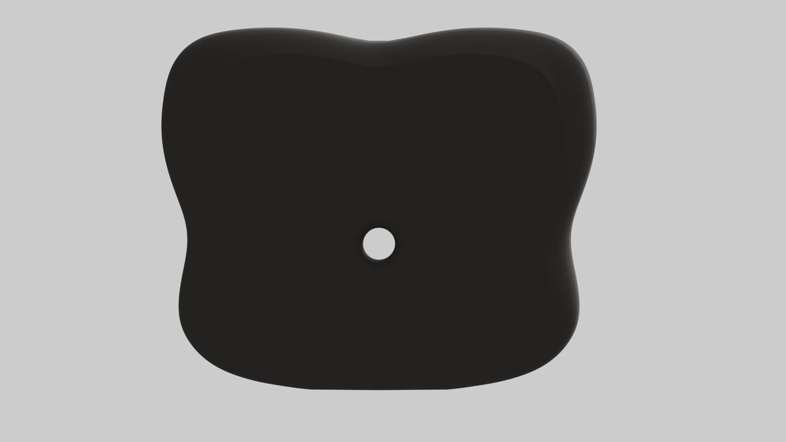
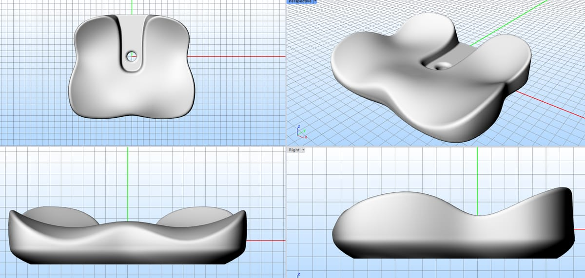
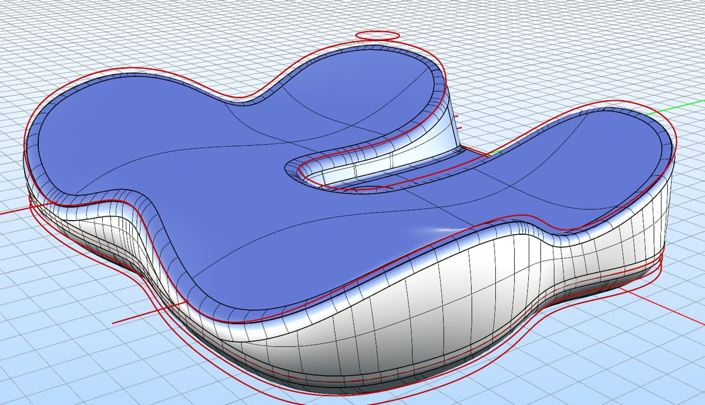

> **分类**：建模渲染 ｜ **编号**：cushion ｜ **完成时间**：2026-10-17
>
> **使用工具**：Rhino / Blender
>
> **标签**：产品 · 曲面建模 · 渲染

## 说明

试稿题目：给一张尺寸图和几张参考渲图，把这款坐垫还原出来并出渲染。

外轮廓是蝶形的三段支撑——两侧承臀、中间一道凸起、后缘收出一道凹槽，中心开一个通孔。Rhino 里先按尺寸（约 439 × 378 mm，高 114.53 mm）拉出主曲面，用控制点把三段之间的过渡修顺；再导进 Blender 补圆角与细分、布光渲染。材质先出浅灰版看形体，再出深色版本。

## 预览

## 素材

| 项目 | 说明 |
| --- | --- |
| 尺寸 | 约 439 × 378 mm，高 114.53 mm（按给定尺寸图） |
| 建模 | Rhino（NURBS 曲面）→ Blender（圆角、细分、材质） |
| 渲染 | Blender：浅灰无缝背景 + 柔光为主，另出深色版本 |
| 输出 | 渲染 7 张，另附 2 张过程截图（四视图 / Rhino 曲面编辑） |

制作时间跨度：2026-10-15 ～ 2026-10-17
