> **分类**：建模渲染 ｜ **编号**：power-wallet ｜ **完成时间**：2026-10-11
>
> **使用工具**：Blender
>
> **标签**：产品 · 渲染 · 练习

## 说明

照着市售磁吸充电宝卡包的公开产品图与尺寸图做的临摹练习：5000mAh 磁吸充电宝与卡包做成一体，背面一枚无线充电线圈标识，底部留出卡槽与支架。

建模先按尺寸图对齐比例、圆角与分模线，做出正 / 侧 / 背三视图确认体量，再铺皮革材质与缝线；渲染沿用棚拍思路——浅灰无缝背景、柔光箱作主光、侧后补光压出边缘。后半程换了几个场景，把手机、耳机、键鼠这些现成模型摆进去试构图。

## 预览

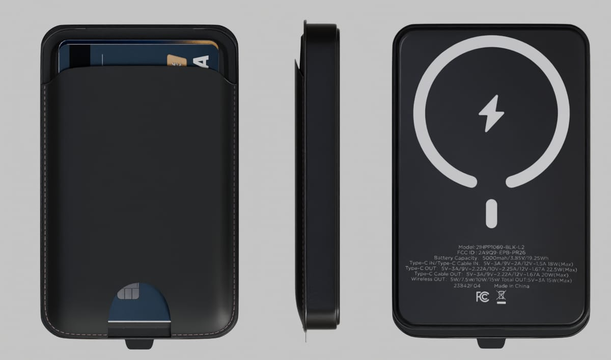
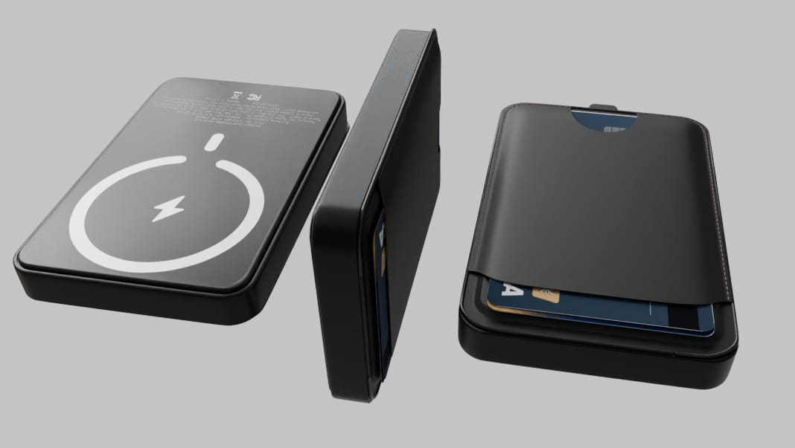
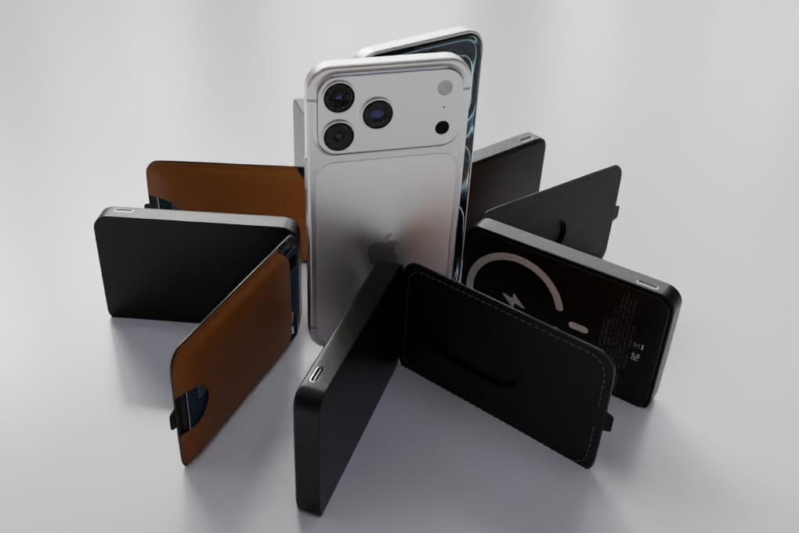
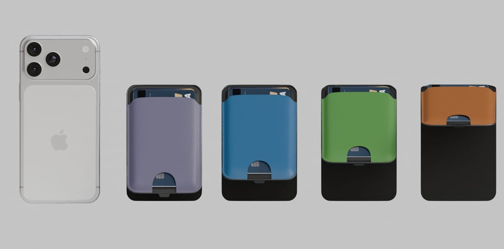
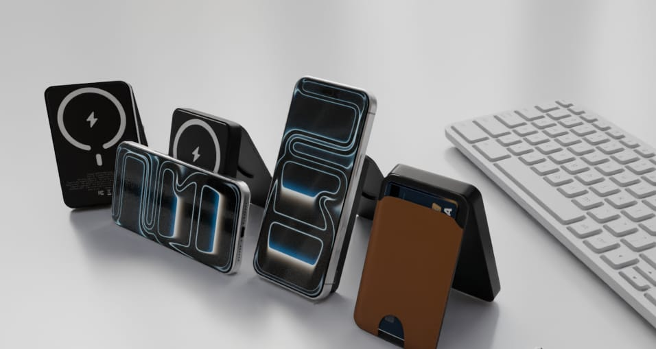
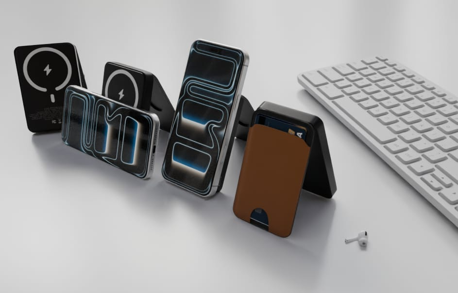
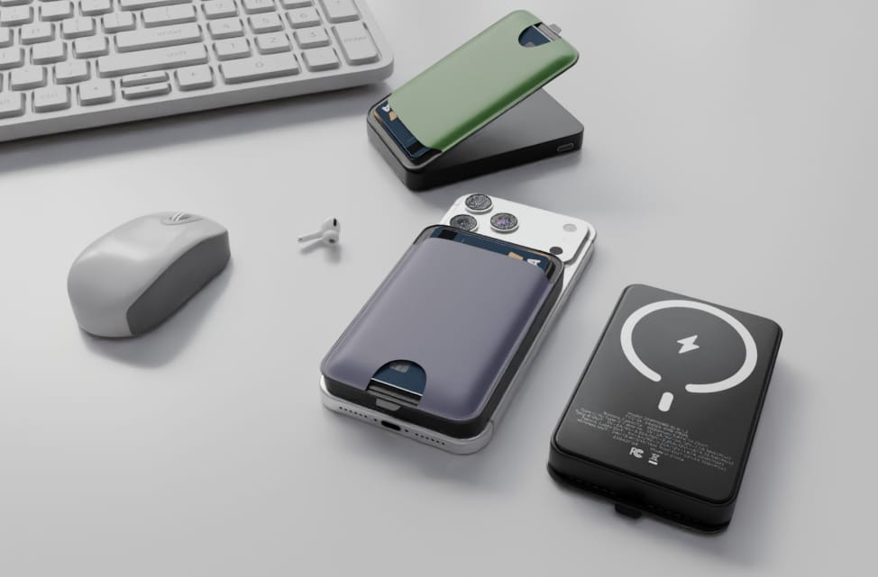
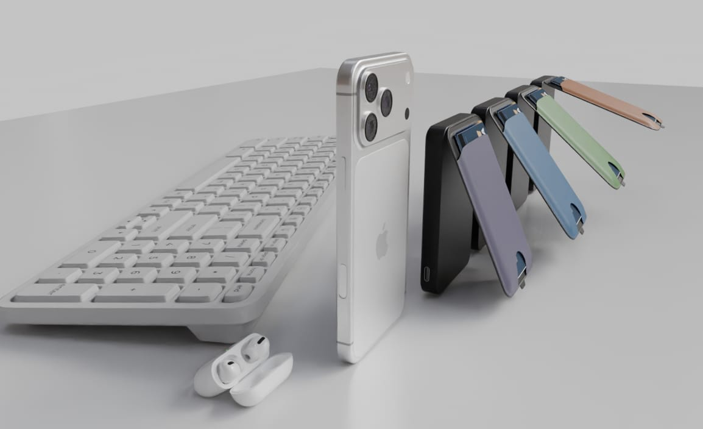
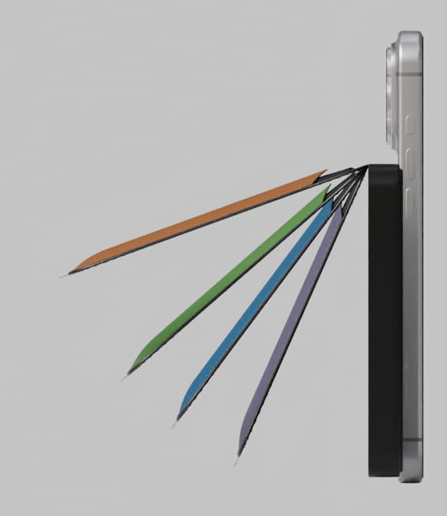
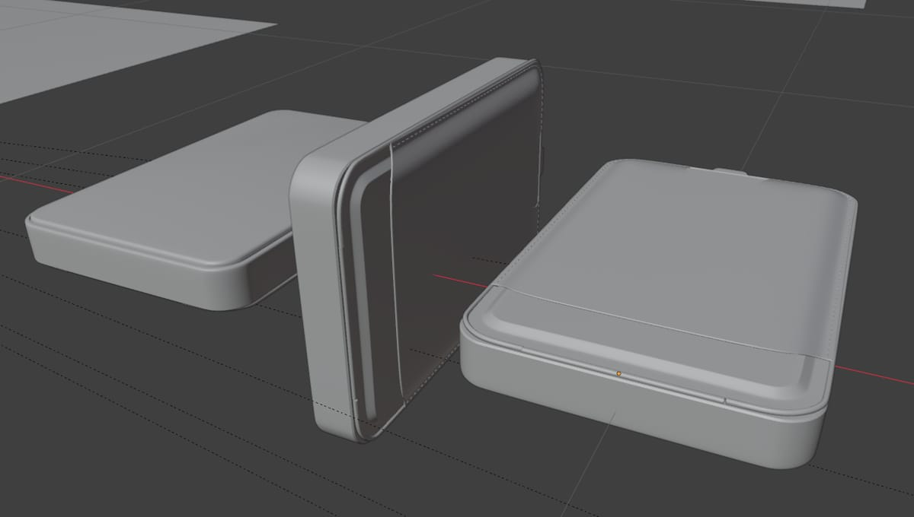
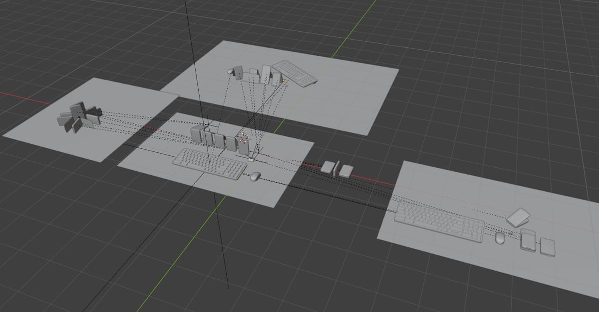
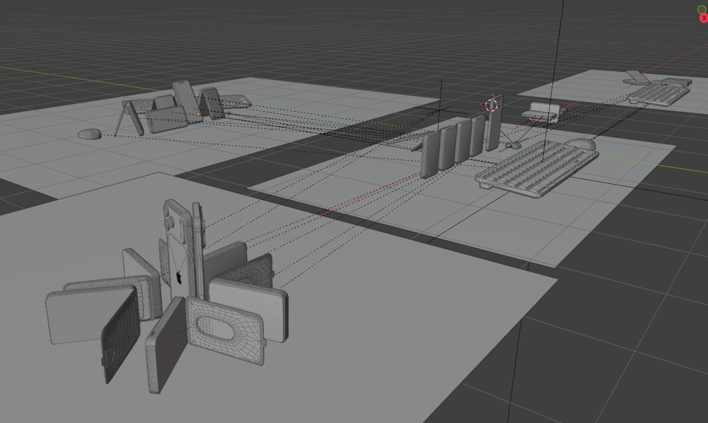

## 素材

| 项目 | 说明 |
| --- | --- |
| 参考 | 市售同类产品的公开产品图与尺寸图 |
| 场景资产 | 现成的 iPhone / AirPods / 键鼠模型 |
| 输出 | 棚拍渲染 10 张，另附 3 张视口过程记录（10–12） |

制作时间跨度：2026-10-09 ～ 2026-10-11
